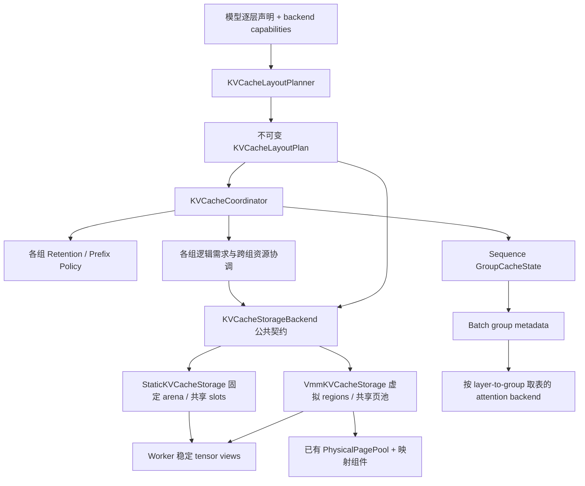

# xLLM Hybrid Attention KV Cache 管理实施计划

<!-- Copyright 2026 The xLLM Authors. Licensed under the Apache License, Version 2.0. -->

状态：静态 Full/Linear 共享后端已实现，正在验证。日期：2026-11-02。第 1–10 节保留总体演进路线，当前实现范围和页布局以第 11 节为准。

- xLLM 基线：上游 `xLLM-AI/xllm` 的 `main`，`9a656af7bfae7f77dfd7f9401987a603d50cda22`。
- vLLM 参考：`main` 的固定提交 `5689c2790c911a55c75825aac5166305df0b591d`。
- 目标分支：`features/rearch_kv_cache`。
- 当前工作树已包含静态共享 arena、共同页布局、加权资源池及 native NPU 接入；尚未完成最终提交上的 NPU 全量验收，也未测量性能收益。

## 1. 目标与设计结论

将 xLLM 已有的 flat KV、DSV4 SWA/C4/C128、GDN recurrent state 管理统一为：

**逐层声明缓存规格 → 按缓存生命周期分组 → 各组独立逻辑 block table → 统一存储后端提供共享物理容量 → 协调所有组的准入、回收和共同前缀恢复。**

核心收益目标是让短窗口或 recurrent group 释放的容量能被其他 group 使用，去掉 attention 类型之间的静态容量隔离。正确性和实际占用可作为验收依据；吞吐、TTFT、TPOT 的变化需要测量。

第一条端到端路径选择 NPU、单实例、Full Attention + SWA，覆盖多窗口和 chunked prefill。以现有 KVCachePageBackend 为起点形成统一存储边界，提供静态 arena 和 VMM 两种实现；P1 先用最小兼容布局验证两者共享的容量与所有权契约，再在 P2 接通同一套上层策略。VMM 继续复用已有 PhysicalPagePool、稳定虚拟地址和映射事务。随后接入 APC、Full + GDN、DSV4 压缩缓存、Host/PD。纯 Full 模型必须保持原有行为。尚未完成的组合在初始化按明确能力矩阵选择已有受支持路径或拒绝新策略，不能在执行失败后切换。

vLLM 的保留、共享容量和前缀协调策略作为语义基准；物理布局由后端能力决定。静态后端首先采用固定 C 的共享 slot/lane 布局，运行时只调整池内所有权；VMM 可以让各组使用不同 tensor shape 和页成本，无需预先强制所有组拥有相同层数或相同缓存块字节数。两种后端不要求物理布局相同。VMM 的页内 packing 作为独立优化，是否实现由 P1 的实际驻留内存和映射成本决定。

## 2. vLLM 中需要迁移的实际机制

以下结论依据固定提交源码。vLLM 的 hybrid 设计文档仍描述较旧实现，其中“只能 Full + 一种其他 attention”和“所有层 page bytes 必须一致”的限制不能直接作为现行约束。

| 机制 | 当前 vLLM 行为 | xLLM 对应决策 |
| --- | --- | --- |
| 规格与分组 | CacheSpec 描述存储及保留语义；同组层共用逻辑表；每组 policy 使用共享 BlockPool | 分离 layer spec、group identity、物理池与模型 adapter |
| 内存单位 | 池中固定分配单元为 `C` 字节；各组可具有不同 token block size，最新实现也支持部分 mixed-page packing；N 还包含保留 ID | VMM 按真实硬件页需求统一计费，区分虚拟 block ID 与物理 page ID；固定 C 路径使用 `N_usable=N-N_reserved` |
| 分组 | 同构页路径采用层数启发式及 padding，不是层数 GCD；mixed-page 路径按生命周期分桶并打包 | VMM 首先按生命周期及 backend 兼容性分组，不强制等层数；lane/padding 作为独立布局优化 |
| 生命周期 | Full 保留全部历史；SWA 只保留实际窗口及执行余量；chunked-local 按 chunk 退休；recurrent 保留 working state 与 checkpoint | 为这些真实变化点提供 policy；GDN 不能当作 `window=1` 的 SWA |
| 空闲与淘汰 | 同一池维护 ownership、空闲队列及 group-aware cache key；未缓存块优先复用，缓存块按释放顺序淘汰 | 建立跨组 eviction；无需沿用每 leaf 一套独立 LRU |
| 前缀复用 | key 包含 group；各类型返回可恢复边界；多类型通过单调缩短的固定点求共同 hit | 不直接取一次 `min(group_hit_tokens)` |
| 异步边界 | 先按已完成的安全边界退休，再申请新块；in-flight/spec tokens 纳入需求 | 保留 schedule overlap、spec rollback、transfer lease 的执行生命周期 |

主要源码依据：

1. [规格与 group](https://github.com/vllm-project/vllm/blob/5689c2790c911a55c75825aac5166305df0b591d/vllm/v1/kv_cache_interface.py#L1506)、[coordinator 注入共享池](https://github.com/vllm-project/vllm/blob/5689c2790c911a55c75825aac5166305df0b591d/vllm/v1/core/kv_cache_coordinator.py#L111)。
2. [分组启发式](https://github.com/vllm-project/vllm/blob/5689c2790c911a55c75825aac5166305df0b591d/vllm/v1/core/kv_cache_planning.py#L501)、[物理块字节及 backing views](https://github.com/vllm-project/vllm/blob/5689c2790c911a55c75825aac5166305df0b591d/vllm/v1/core/kv_cache_planning.py#L594)、[mixed-page packing](https://github.com/vllm-project/vllm/blob/5689c2790c911a55c75825aac5166305df0b591d/vllm/v1/core/kv_cache_planning.py#L930)。
3. [SWA/Chunked 容量上界](https://github.com/vllm-project/vllm/blob/5689c2790c911a55c75825aac5166305df0b591d/vllm/v1/kv_cache_interface.py#L861)、[运行时退休与分配顺序](https://github.com/vllm-project/vllm/blob/5689c2790c911a55c75825aac5166305df0b591d/vllm/v1/core/kv_cache_manager.py#L556)。
4. [group-aware lookup](https://github.com/vllm-project/vllm/blob/5689c2790c911a55c75825aac5166305df0b591d/vllm/v1/core/block_pool.py#L202)、[块复用及淘汰](https://github.com/vllm-project/vllm/blob/5689c2790c911a55c75825aac5166305df0b591d/vllm/v1/core/block_pool.py#L706)。
5. [多组前缀固定点](https://github.com/vllm-project/vllm/blob/5689c2790c911a55c75825aac5166305df0b591d/vllm/v1/core/kv_cache_coordinator.py#L806)、[recurrent state 生命周期](https://github.com/vllm-project/vllm/blob/5689c2790c911a55c75825aac5166305df0b591d/vllm/v1/core/single_type_kv_cache_manager.py#L1428)。
6. [不同 token block size 的对齐](https://github.com/vllm-project/vllm/blob/5689c2790c911a55c75825aac5166305df0b591d/vllm/v1/core/kv_cache_utils.py#L764)。

## 3. xLLM 现状和需要解除的耦合

| 当前代码 | 已有能力 / 约束 | 改造方向 |
| --- | --- | --- |
| `core/framework/block/composite_block_manager.{h,cpp}` | 已有跨 leaf stage/commit、SWA 稀疏尾窗、GDN checkpoint APC；`LeafMap` 按 BlockType，组合固定为 FLAT_KV、FLAT_KV_LINEAR、SWA_COMPRESSED | 保留编排门面，改为 descriptor 驱动；删除模型组合枚举 |
| `core/kv_cache/block/block_manager_impl.cpp` | leaf 各自构建 free list、PrefixCache、LRU | VMM 保留组内虚拟槽分配，共用底层物理页；统一跨组压力淘汰，区分虚拟空槽与可回收物理页 |
| `core/kv_cache/block/block.{h,cpp}` | BlockType 同时是角色、sequence key、固定 worker 列、PD group id；Block 的 token size 来自 owning manager | 引入独立 CacheGroupId；物理句柄与组的 token granularity 分离 |
| `core/framework/request/sequence_kv_state.{h,cpp}` | maps 按角色索引，worker 固定导出 SWA/C4/C128；coverage 对 KV/C4/C128 有特判 | 连续 group state + plan 索引；coverage 由各 policy 证明 |
| `core/kv_cache/layout/kv_cache_{capacity,shape,estimation}.*` | model-global shape、独立 SWA/C4/C128 数量、先预留 LINEAR 池再算 Full 数量 | 按 rank 的 LayoutPlan 统一推导实际 backing、padding、容量 |
| `core/framework/model/model_args.h:1242-1275` | closed binary 分类：除 `full_attention`、`attention`、`deepseek_sparse_attention` 外全部按 linear；新 SWA 类型若直接进入会被错误分配 Conv/SSM | 在 model/backend adapter 边界生成 typed per-layer spec，再由 factory/storage 派生 |
| `core/framework/block/block_manager_pool.cpp`、`core/scheduler/scheduler_policy.cpp` | capacity_leaf 只报告一个组；多处按 KV / 单一 block_size 推导 admission | KV manager 集中计算全组物理需求，scheduler 消费结果 |
| `core/framework/batch/forward_input_builder.cpp`、`core/layers/common/attention_metadata.h` | flat 单表与 DSV4 固定多表并存；共享一次 forward 的 metadata | 显式 group-id tables，layer-to-group 静态映射 |
| `core/runtime/forward_shared_memory_manager.cpp`、`core/framework/model/llm_model_params.h`、`proto/worker.proto` | flat table 和按序号的多表传递 | 携带 schema/plan identity 与 group id，贯通 clone/to、RPC、共享内存、Python |
| graph runners 与 `core/runtime/py_attention_metadata.*` | 持久化 metadata 主要围绕单表或既有特化字段 | 按固定 group plan 预分配；capture/replay 使用同一组布局与地址 |
| `core/kv_cache/storage/kv_cache_utils.*`、`kv_cache_tensor_allocator.{h,cpp}` | allocator 仅接收 role/shape/dtype/device；默认实现逐 tensor 调用 torch::zeros，缺少 group/layer/offset/stride 上下文 | plan-driven storage builder 显式解析 group/layer/role→offset/stride→views；静态后端改用计划驱动的共享 backing |
| `core/kv_cache/storage/kv_cache_page_backend.h` | 已有物理容量 reserve/release/available 和 VMM map/unmap；参数按 model+DP，未表达 hybrid group/layout | 作为统一存储边界的演进起点；公共契约描述存储需求与所有权，具体 map/unmap 留在 VMM 实现 |
| `core/framework/block/hierarchy_block_manager_pool.cpp`、transfer 模块 | 已有 Host/PD 分组 manifest、restore dependency、异步 leases | 扩展现有 descriptor 边界，保留 completion-before-publish |
| `core/framework/block/vmm_kv_block_manager.*`、`layout/vmm_kv_cache_layout.*` | VMM 与 KV leaf 绑定，已有 APC retain、page mapping、target/draft 计费 | 前移为首条存储路线；按 group 管理虚拟槽及映射 geometry，共用现有物理池与预算 |
| `storage/vmm_kv_page_allocator_impl.*`、`virtual_kv_cache_memory_{registry,regions}.*` | 按 model+DP 管理一个映射成本；一次映射展开到登记的全部 K/V/INDEX 层；已有 mapping_group 表示多个 member 同步映射 | 增加独立 CacheGroupId、每组映射范围和成本；保留 target/draft 同步映射的独立语义 |
| `framework/allocator/virtual_memory/{physical_page_pool,mapped_virtual_memory_region}.*` | 已有 eager/lazy 物理 backing、共享硬件页池、虚拟范围独立保留、批量映射及新映射失败回滚 | VMM 后端直接复用；预分配与 VMM 寻址是独立维度；缓存生命周期规则仍由上层 group policy 负责 |

上表路径均相对 `xllm/`。DSV4 和 GDN 已有语义应成为回归基线，不能作为新抽象的副作用删除。

## 4. 领域对象和职责



| 对象 | 唯一职责 |
| --- | --- |
| `KVCacheSpec` | 存储格式、tensor roles/dtypes、tokens_per_block、保留规则参数、checkpoint 粒度；可使用数据聚合和类型安全 variant |
| `KVCacheGroup` | 同一 logical table 和生命周期的层集合；持有不透明且稳定的 CacheGroupId |
| `KVCacheLayoutPlan` | group/layer 映射、每 rank 的后端能力与物理成本、alignment、辅助资源；静态布局含 C/N、slice/stride、alias 和 padding，VMM 布局含 tensor 虚拟范围及 mapping geometry；构建后只读 |
| 组内 block 分配状态 | 管理 group 内逻辑块、存储句柄的引用所有权、缓存索引及 null/sentinel；VMM 另管理组内虚拟槽，不把虚拟 block 数当作共享物理容量 |
| `KVCacheStorageBackend`（拟演进现有接口） | 按已解析 layout 提供 backing/views、需求成本投影、容量快照、reservation 与存储句柄；隐藏静态 slot 和 VMM 页的区别，不解释 attention 窗口、prefix 或模型名称 |
| `StaticKVCacheStorage`（拟新增） | 初始化固定共享 arena 与 views；运行时从统一 slot 池分配/归还，空闲 backing 保持驻留 |
| `VmmKVCacheStorage`（拟适配现有实现） | 管理各组虚拟范围、映射成本和页面绑定；复用已有 PhysicalPagePool、VmmKVPageAllocator 及映射组件，支持预分配或弹性 backing |
| group policy | 计算需保留的 logical 范围、增量块数、可退休块、可恢复 prefix；不持有独占物理 free list |
| `KVCacheCoordinator` | 共同恢复点、跨组 admission/reservation、commit、publish 和 release；现有 Composite/KVCacheManager 接口作为迁移门面 |
| `GroupCacheState` | 请求各组的 logical table、computed/published 进度、checkpoint/working-state 引用；不按逻辑 vector 长度统计物理占用 |

新接口不能把已有 EMBEDDING/speculative 辅助资源强行解释成 attention token page。它们在预算中显式计费，并在 coordinator 中作为必要资源参与 admission；是否纳入同一物理分配路径由真实布局决定。

### 4.1 公共存储契约与实现边界

上述类型名称为设计名称，最终接口优先演进现有 KVCachePageBackend，而不是增加一套长期并存的物理分配框架。公共契约表达以下行为，不要求静态实现模拟设备 map/unmap：

1. 按初始化时选定的 LayoutPlan 创建稳定 backing/views，显式指定 group/layer/role；向上层返回布局能力与容量快照。
2. 将已解析的逻辑需求投影成存储成本并尝试 reserve；reservation 在提交前可取消，所有参与 rank 都具备资源后才发布 group tables。分布式 prepare/commit/abort 继续由现有 coordinator 编排，本地物理后端不负责跨 rank 协议。
3. 提交后返回带明确所有权的存储句柄及执行所需 block IDs。静态实现返回共享 slot，VMM 实现返回组内虚拟槽并完成必要页映射；逻辑块身份、存储槽和硬件物理页不得被约定为同一个整数。
4. 最后一个 active/APC/执行/传输引用释放后归还存储。静态 slot 回到共享空闲池；VMM 只有整个硬件页可释放时才能解除映射或归还 backing。沿用现有映射/解除映射失败边界，不把部分 unmap 当成可取消的成功释放。

能力和布局在初始化选择。热路径直接使用已解析的 group 索引、句柄和预分配 metadata，不因每层创建 views 或解释模型参数增加调度工作。具体锁、批处理粒度和元数据成本以实现测量为依据。

### 4.2 分配时机与寻址方式是两个维度

| 寻址方式 | 启动时固定预分配 | 按需提交/释放设备 backing |
| --- | --- | --- |
| 静态 arena | 本计划的 Static 实现：固定驻留内存，运行时共享 slots | 首版不实现可增长 arena；稳定 views 和 kernel 间接寻址需要另行支持 |
| VMM | 现有 PhysicalPagePool 已支持 `lazy=false`，物理页预分配、映射仍可变化 | 复用 `lazy=true` 及现有增长/回收逻辑，并按组管理映射 |

因此，如果“静态”仅指提前分配全部 VMM 物理页，可以直接复用 eager pool；如果还要求不依赖 VMM 的后端，则新增静态 arena 实现。后端选择与 backing 提交策略在内部独立建模，不为首版增加不必要的配置组合。

## 5. 物理布局、分组和容量计算

### 5.1 VMM 后端：各组虚拟存储独立，共享硬件页

区分四级索引：`token logical position → group 内 virtual block ID → tensor 虚拟 byte offset → 硬件物理页`。vLLM 的 physical block 是缓存分配单元，不等同于 VMM 的设备物理页。不同 group 可以有相同数值的 virtual block ID，完整身份必须带 group；物理页所有权由现有池和映射维护。

每组保留各层 tensor 所需的虚拟范围，按自己的 shape/dtype/block size 建立 mapping geometry；统一从已有 PhysicalPagePool 获取硬件页。共享容量不要求不同组的 tensor 虚拟地址相同，也不要求等层数 padding。组内逻辑表仍按生命周期协同；硬件映射批次覆盖该组所需 tensor roles，而非整个模型的所有 K/V/INDEX。

令硬件页大小为 H。布局与 allocator 将本轮逻辑槽需求转换为去重后的 `(tensor region, page-aligned offset)` 集合，扣除已有映射，得到每个参与 rank 的 `delta_pages_r`。准入需要所有 rank 的新增硬件页及辅助资源均能在共享预算中 reserve；不能把不同成本 group 的空闲虚拟块数相加，也不能沿用每个 model 一个 `phy_pages_per_virt_page` 的统一倍数。权重、target/draft、已驻留 reserve、graph/runtime 费用按既有预算边界计费一次；全组 reserve 与映射失败回滚后再发布逻辑表。

VMM 的限制是整页回收：SWA 退休一个小 block 后，该虚拟槽可以在本组复用；所在硬件页仍承载 active/APC/in-flight block 时，整页无法跨组归还。当前 `VmmKVBlockManager` 仅在 virtual page 全空时调用 page allocator；allocator 还可能保留已映射 reserve 页。必须在跨组压力下协调 cache eviction 和 idle reserve 归还，避免为每组机械复制 8–32 个 reserve 页而重新形成静态隔离。映射/解除映射按页批量执行，不按每个 token 重映射。

P1 对短窗口、低/高并发、cache-only 碎片实测 `live block bytes`、`mapped physical bytes`、`可跨组回收 bytes`、reserve 滞留和 mapping 次数/延迟。若独立 group 映射的大页碎片抵消收益，再在同一共享物理池上评估固定 C 或其他页内 packing；不能仅由 live block 数证明物理容量收益。

可复用源码：`framework/allocator/virtual_memory/physical_page_pool.h:34`、`mapped_virtual_memory_region.cpp:174`；需细化的边界：`storage/vmm_kv_page_allocator_impl.h:136`、`virtual_kv_cache_memory_regions.cpp:256`、`virtual_kv_cache_memory_registry.cpp:114`。现有 registry 的 mapping_group 用于 member 同步映射，与 hybrid group 的独立生命周期分别建模。

### 5.2 静态后端：固定 C 的共享 slot/lane 布局

静态是物理 backing 的驻留方式，不是按 attention group 固定划分容量。启动时分配共享 arena，构建各组所需的固定 tensor views；调度阶段只分配池内 slot、更新逻辑表并回收所有权，不重新分配大 tensor。现有默认 tensor allocator 逐层分配独立完整 tensor 的方式，尚不具备跨组共享容量能力。

普通 arena 无法把任意物理页重新拼到各组连续虚拟地址中，因此需要由 layout 和 kernel 共同支持的固定 slot/stride/alias。首版以固定 C 的同构 lane 为基线；不兼容的 dtype/stride/layout 在初始化按能力矩阵处理，不以运行时复制或伪 map/unmap 隐藏差异。VMM 的 eager pool 不受这项静态寻址限制。

令组 g 中一层的实际物理 page bytes 为 `P(g,l)`，包含 K/V、scale、index 或 conv/SSM 等属于该缓存资源的 tensors 及对齐：

```text
C_r = align_up(max_g(sum_l P_r(g,l)), backend_alignment_r)
N   = min_r floor((available_bytes_r - fixed_reserve_r) / C_r)
N_usable = N - N_reserved
D(request) = sum_g required_live_blocks(request, g)
```

`r` 是必须保持相同 block-ID 容量的 TP/CP 等 rank；每个 DP pool 独立协调。辅助的 block-paired 资源若不包含在 C 中，必须加入精确的每块额外成本再求 N；固定 state、graph scratch、target/draft 和非缓存运行时预留只计费一次。APC 可淘汰块不能重复计入“已用不可回收”和“可用”两边。

各 group 的 tensor views alias 同一 backing 地址区间，但同一时刻不能占有相同 physical ID。因此共享池是**跨组复用物理容量**，并不意味着多个组拿相同 ID 写不同内容。N 包含 null/padding 等保留 ID，最大并发和 admission 必须以 `N_usable` 及动态 pinned/evictable 状态计算。不同层 group 之间的 alias、stride 和 kernel 接受的页布局必须同时成立。

同构 lane：`S` 层一组、每层页 `P`，则 `C=S*P`。可采用 vLLM 当前启发式：通常 `S=min(type_layer_counts)`；若最大层数 `<1.5*最小层数`，优先用最大值减少小尾组。未填满的 lane 仍占物理容量，必须显示 padding，不能为了整除使用 GCD 生成过多组。该启发式不约束 VMM 独立 group 路径。PP/layerwise split 投影后重算各 rank 的 backing 和 scratch 费用。

允许一个 group 内不同 `P(g,l)` 的紧凑打包。若 backend 不能表示 block stride、跨 dtype offset 或 padding，该路径只接受已验证的同构方案。扩大 B 只在 attention kernel、scheduler 和 hash 粒度都支持时采用；不能仅为对齐 recurrent state 就任意扩大 B 或对 MLA 填充。

静态 slot 释放会增加池内可分配容量，设备驻留字节保持不变；VMM backing 释放才可能降低设备驻留字节。两者都需要报告 active/pinned/evictable/free 容量，但静态 slot 数、VMM reserved/mapped/resident/reclaimable bytes 和驱动 free bytes 必须分别解释，不能共用一个含义不清的“剩余显存”指标。

### 5.3 缓存有效字节示例

10 Full + 20 SWA 层，`B=16`、`W=32`、每层页 `P`，拆成三个各 10 层的 group。`C=10P`。在 `L=112`、无在途 token 且窗口边界对齐的稳态：

```text
Full: 7 IDs，SWA-1: 2 IDs，SWA-2: 2 IDs
共 11 IDs，110P；全层全量保存则为 30*7P = 210P。
```

这只是固定 C 路径的有效字节示例；运行中窗口不对齐和一次 prefill/verify 写入会临时增加需求，不能把每个 SWA 恒定限制为 2 块。VMM 可将这 10/20 层分别组成两个 group，有效数据同为 110P，但真实 mapped bytes 还取决于各 tensor 的硬件页取整、页内碎片及 reserve，不能直接声称只占 110P。

### 5.4 统一容量模型

- Full：按将要读写的 token 范围向上取整，包括本轮 lookahead。
- SWA：依安全 computed 边界退休，保留窗口、spec/rollback 和 in-flight 所需范围。可参考 vLLM 上界 `ceil(min(W-1+extra_retained+max_in_flight,max_model_len)/B)+1`，但 xLLM 的 `max_in_flight` 必须由实际 overlap/chunk/verify 契约推导。
- Chunked-local：按 attention chunk 保留，不能与 serving 的 chunked prefill 混淆；在模型确有此类型时接入。
- GDN/recurrent：分别计算 working state、checkpoint、复制/verify 暂存的生存期，不用 `ceil(tokens/B)` 推算 state 数量。
- Compressed：C4/C128 以原 token coverage 与压缩倍率声明，保留额外 index/scale、压缩生成和 lookahead 的依赖。

同一个 policy 的逻辑需求函数结合布局/allocator 的物理成本投影，服务启动估算、`exceeds_total_capacity`、本轮 admission、DP 选择和指标；scheduler 不再复制窗口公式。VMM 物理需求取决于当前映射状态；固定 C 路径按统一块成本计费。

## 6. 运行时分配、回收与前缀恢复

### 6.1 一次调度的流程

1. 从已完成且不再被在途执行读取的边界，计算各组可退休完整块；释放已确认不再需要的引用。已证明安全的退休允许在后续 allocation 失败时保留。
2. 为所有组求共同 prefix restore point，获得并 pin 命中块；计算本轮所有 group 和辅助资源的增量需求。
3. 将各组增量需求交给公共存储边界投影成本，协调可安全回收的缓存、整页和 reserve，在共享预算中 reserve；VMM 分配组内虚拟槽并执行映射事务，静态后端分配统一 slots。命中块 acquire 与 eviction 使用同一 ownership 规则，不能预测成功后又把将使用的 hit 淘汰。
4. 全部资源具备后统一挂载 group tables 和更新 allocation state；容量不足时返回 expected shortage，释放本轮暂存引用，不推进 token/computed cursor。
5. forward 完成后推进 computed；只发布已完成且 hash 依赖满足的完整块/checkpoint。allocated、computed、publishable 分别记录。
6. cancel/preempt/finish 后按组释放；设备/PD/Host 仍持有 lease 的页需等实际完成后才能复用或 unmap。

SWA 继续采用绝对 logical index + invalid/null placeholders，初版不增加 ring-buffer 重编号。只退役整个窗口外的完整块，保留现有 speculative lookahead；长序列逻辑表与真实驻留页数分别统计。空槽不能被作为有效 KV 读取或写入。

### 6.2 APC

- 逻辑 key 包含模型/target-draft/cache namespace、plan/group identity、已有 TEXT/MM/MTP 语义和 prefix chain hash；group id 不取自 `BlockType` 数值。
- Full 的命中向下闭合；SWA 必须证明候选结束点前的所需窗口连续可用；GDN 必须存在准确边界的 checkpoint；compressed policy 证明对应生成依赖。
- 从最大候选结束点开始，任一 group 缩短候选后重新检查其他非向下闭合组，直到固定点，支持多个窗口及没有 Full group 的情形。
- 普通组首版采用可缓存 token block size/checkpoint stride 的共同合法对齐；区分 hash 粒度、scheduler 粒度、hit 粒度。vLLM 的默认 hash GCD、常规 hit LCM 可作为基础；遇到 xLLM MTP lookahead/压缩 offset，需显式纳入合法边界规则。
- cached checkpoint 和共享 prefix 不允许原地修改。继续生成前准备独立 writable state，copy 完成前保留源 lease。recurrent sub-block hit 和共享尾块 COW 在相应能力完成后启用。
- 保留 exact-repeat 最后 token/logits 重算，以及 DSV4 稀疏窗口和 GDN restore 现有契约。可选的周期性 sparse checkpoint 保留策略不作为首版必选项。

## 7. Worker、协议、graph 与存储适配

1. Model loader/adapter 在模型初始化声明每层 spec；backend 返回布局能力。缓存层不再到处解析 model_type、full_attention_interval 或 compress_ratios。C++ 与 Python 模型消费同一声明结果。
2. Sequence→Batch→ModelParams→RPC/共享内存→AttentionMetadata 贯通带 group id 的 tables、slot mappings 和 recurrent read/write indices。`layer_id→group_id` 在初始化计算；每步共享公共 q/seq metadata，按 group 构建必要表，避免每层重建或 map/hash 查找。FlashInfer plan、FA3 scheduler metadata、shard 派生和 expanded-decode metadata 也按兼容的 group/config 共享；不能继续假设只为 layer 0 更新一份全模型 plan。
3. `KVCache` 保留逐层 tensor façade，统一由 plan-driven builder 适配存储后端。VMM 路径由 plan 中 group/layer/role 创建独立虚拟 tensor region，物理 backing 从同一页池提供；allocator 不再按调用顺序猜测 layer，registry 不再为同一 model 的全部同类 tensors 强制同一 shape。静态后端初始化共享 arena、offset/stride 和 backing alias，运行时只更新 slot 所有权及表值。仅替换 free list、仍给每层独立分配完整物理大 tensor，不能达到共享内存效果。
4. Graph 为实际 group plan 预分配持久表和 padding/null 区，确保地址稳定；graph identity 包含影响 capture 的 group/layout/shape；更新表值不重新分配。同步修改 eager、expanded decode、spec verify 和 Python metadata 通道。
5. PD/Host 沿用现有 logical manifest、tensor roles、owner rank、reshard spans、lease。新增稳定 group schema/plan compatibility 校验，区分 block-scoped 与 sequence-scoped state；旧 BlockType wire 值由兼容 adapter 解释。Host/device physical ID 不互传为对方 ID。
6. VMM 在 P1/P2 完成 group 独立 geometry、虚拟槽、预算和映射事务；复用现有分布式 prepare/commit/abort，不重建底层物理池。推导每 tensor view 的真实映射、可回收整页与部分页占用，不使用 `free_IDs*C` 或 live block bytes 代替 mapped bytes。现有 WorkerImpl 和 VmmKVCacheLayout 明确拒绝 grouped layout，并限制 quantized/NZ/KPool 等布局，启用新组合前必须逐项完成支持。保留 APC retain、target/draft 预算、padding block、弹性容量 advisory 语义；稳定 tensor 地址也不能替代 graph 对空洞、表更新和异步 remap 的正确性验证。
7. 原有 beam COW、CP/DCP/PCP、KV split、layerwise split、quantized/index/MLA、MTP 的新布局支持逐项验证。vLLM 自身也有具体 SWA/Chunked 与 DCP/PCP 组合限制，不能从抽象可表示推断 kernel 已支持。

## 8. 分阶段实施及完成条件

| 阶段 | 交付和主要文件 | 完成条件 |
| --- | --- | --- |
| P0：基线与公共契约 | `layout/kv_cache_spec.h`、`kv_cache_group.h`、`kv_cache_layout_plan.*`（拟新增）；演进 KVCachePageBackend；args typed 分类及 factory/estimator descriptors | Flat、DSV4、GDN 兼容 descriptors 与原容量/shape 一致；确定布局能力、成本/容量与所有权契约；分别输出静态 C/N/padding 和 VMM geometry/页成本；保持运行语义 |
| P1a：静态共享原型 | 新增 StaticKVCacheStorage（设计名称）；复用 block pool 基础组件，调整 tensor builder 和 layout 创建共享 arena/views | 最小同构 Full/SWA 布局的 group 独立逻辑表、共享 slot 池；SWA 释放 slot 可由 Full 复用，无污染；运行时不增配大 tensor，lease 持有期间禁止复用 |
| P1b：VMM 按组适配 | VmmKVCacheStorage 适配；复用 PhysicalPagePool/MappedVirtualMemoryRegion；修改 VmmKVBlockManager、VmmKVPageAllocatorImpl、registry/regions、layout、tensor allocator 及 mapping RPC | 使用相同公共契约，独立虚拟范围与 block namespace，共享物理池及预算；验证 eager/elastic backing、跨组页归还/再映射、全 pinned 和映射失败；量化碎片/reserve 和映射成本 |
| P2：首条端到端 | composite/coordinator、sequence state、capacity planner、scheduler policy、input builder、metadata、RPC/shared-memory、NPU eager/graph | 同一上层 Full+SWA、多窗口、chunked prefill、无 APC 基础路径分别运行静态与 VMM 后端；SWA 释放的 slots/整页可供 Full 使用；准入按后端真实成本，部分 VMM 页不冒报可跨组回收 |
| P3：通用 APC | group prefix policy、prefix index/hash、coordinator；扩展既有 prefix/composite 测试 | 多类型固定点、空洞尾窗、group 隔离、全 miss/exact repeat 正确；cache hit 不被本次分配误淘汰 |
| P4：GDN 与压缩缓存 | linear state/storage/checkpoint、Qwen3-Next/Qwen3.5 adapter、DSV4 SWA/C4/C128/index adapter | working/checkpoint 正确隔离；DSV4 原 token coverage 及 C128 restore 行为不退化；按 state/role 真实页需求计费；按实测结果扩展所需 packing |
| P5：生产路径 | hierarchy/Host/storage、PD manifest+coordinator、spec/beam/并行组合、VMM 其余已声明布局 | 已声明支持的路径通过异步取消/恢复/lease/reshard 回归；不再依赖固定三列或 BlockType 等同 group id |
| P6：清理与度量 | 移除旧组合枚举和重复容量公式；metrics、设计/CLI 文档（如新增配置） | 开启新路径后所有启用组合通过回归；现有纯 Full 和未迁移受支持路径保持正确；容量收益与性能数据可重现 |

实施依赖：`P0 → {P1a, P1b} → P2 → P3 → P4 → P5 → P6`。P1a/P1b 在公共契约明确后可并行；首个端到端样本可以先在一个已就绪后端贯通，但 P2 验收覆盖两者。P5 的协议 descriptor 设计应在 P0 完成，传输路径启用等待依赖完成。P2 不代表全部 hybrid 策略已经完成。

## 9. 测试与验收

测试优先扩展真实实现的既有 suites：`tests/core/framework/block/`、`tests/core/kv_cache/{layout,prefix,storage,transfer}/`、`tests/core/scheduler/`、metadata builder、worker/RPC/shared-memory 和 graph suites。

| 验证目标 | 必要场景 |
| --- | --- |
| 布局与容量 | 纯 Full；10 Full+20 SWA；12/13 与 10/52 不整分组；多个窗口；不同 B/P/dtype；TP/CP/PP/layerwise 投影；padding、scale/index、辅助资源实际字节等于预算 |
| 跨组共享 | 静态 arena 中同 slot 跨组复用无污染，运行时驻留字节稳定；VMM SWA 整页归还后可由 Full 再映射；部分页仍有 live/APC/in-flight blocks 时禁止归还；reserve 在跨组压力下可回收；同组层共享表而不同组独立表 |
| 后端公共契约 | 在兼容布局上执行同一申请/退休/取消/APC 序列，逻辑结果与容量不足语义一致；验证静态 slot 与 VMM 页的不同成本及释放结果；预分配 VMM 与弹性 VMM 不改变上层策略 |
| 执行边界 | `B±1`、`W±1`、长 prompt、大 prefill chunk、多轮 decode、overlap/spec/rollback；不因 optimistic scheduled cursor 提前回收 |
| APC | 多组不同 hit 深度；SWA 中间空洞/连续尾窗；准确 checkpoint 缺失；缩短后需二次验证的固定点；无 Full 的多窗口；hash/group/target-draft/MM 隔离；exact repeat |
| 状态与失败 | 原子 reservation、部分资源不足、取消/抢占/恢复、writable state copy、lease 完成前禁止复用；若支持 beam 则逐组 COW |
| Worker/graph | group-id 顺序变化不误路由；clone/to、Python、共享内存/RPC round trip；eager/graph 和 expanded/spec 输出一致，graph table 地址稳定 |
| Host/PD/VMM | 延迟 completion、取消时远端仍写、restore 依赖、不同 TP/KV split、逻辑 group schema；page pin、APC retain、部分大页占用、target/draft 实际预算 |

实现阶段在同一模型、dtype、硬件和优化构建上测量：固定字节预算下最大并发、live block bytes、peak allocated/mapped bytes、实际可跨组回收 bytes、部分页与 reserve 滞留、活跃/可淘汰/空闲页、mapping 次数及延迟、group padding、prefix hit tokens、allocator/scheduler CPU 时间、TTFT、TPOT/p99 和吞吐。对比现有策略或受支持的全历史参考；混合长短请求、低/高并发及低/高 cache hit 均覆盖。碎片与映射开销的早期评估在 P1 完成。

验收先满足数值一致性、零泄漏/提前复用、容量计算与实际占用一致，再评估性能。内存示例不当作测得的吞吐收益。每阶段完成适用检查；实际代码发布前需在最终提交上完成可用 NPU 全量回归。

## 10. 后续实现前需要实测确认的边界

这些是实施阶段的技术验证项，不阻塞本次方案与工作树创建：

- 目标 NPU paged attention、GDN、quantized/MLA backend 能否接受计划中的 alias、page stride、padding 和不同 B；以真实 kernel 和 graph 验证决定能力开关。
- 哪个已有模型可作为通用 Full+SWA 首个 NPU 集成样本；DSV4 的 SWA+C4/C128 应单独验收，不能用它冒充 Full+SWA 样本。
- xLLM schedule overlap/spec verify 的完成与提交点，以及最大在途读取范围；使用现有 runtime 契约定义 safe retirement。
- VMM 独立 group 的大页碎片、reserve 滞留和映射成本，尤其是 SWA 短窗口与 GDN 小 state；据实测决定 fixed-C/其他 packing，避免把有效数据减少等同于实际物理占用减少。checkpoint 复制成本单独计量；只有数据证明必要才增加 size-class 等分配复杂度。
- PD schema、rank 投影、辅助资源和 target/draft 的预算规则需要在 LayoutPlan 中闭合，不能把这些费用遗漏到“共享池之外”。

## 11. 当前静态 Full/LINEAR 实施决策（2026-11-02）

首版使用一次预分配的连续 byte arena，Full/LINEAR 从同一物理 page 池分配和回收真实 backing。沿用当前 VMM 已有的逻辑块与物理存储职责分离；静态实现不做设备 map/unmap，不等同于关闭 VMM 的 elastic 开关。

### 11.1 统一 logical page 与共同物理页

共同分配抽象为 logical page，不再增加一套 512-token block。一个 Full logical page 包含最多四个 Full Attention 层、每层一个 token block。若 block_size=128，则是四层各 128 个 token 的 K/V，共 512 个跨层 token 槽；每层序列跨度仍为 128，不能把 scheduler、hash 或 prefix cache 的 token block size 直接改为 512。一个 Linear logical page 包含一层 Conv/SSM working state 及显式检查点行。Linear 的 token checkpoint 步长仍由现有 prefill chunk 配置定义，与层分组分开。

记单 Full 层的一行 K（或 V）字节为 F，Conv 行字节为 C，SSM 单检查点行字节为 S，检查点数为 Q：

    full_page_payload = 4 * (K + V) = 8F
    ssm_offset = align_up(C, S)
    linear_page_end = ssm_offset + Q*S
    payload_bytes = max(full_page_payload, linear_page_end)
    alignment = lcm(F, S)
    candidate = align_up(payload_bytes, alignment)
    max_conv_gap = C - gcd(candidate, C)
    page_bytes = candidate                          if ssm_offset >= C + max_conv_gap
                 align_up(payload_bytes, lcm(F,C,S)) otherwise

Full 和 SSM 保留整行对齐；Conv 行起点向上取整，其最坏间隙必须落在原有 Conv/SSM 对齐空隙内，否则回退到包含 Conv 的 LCM。选择只依赖行字节，不改变四层 Full 分组和算子 tensor ABI。例如 Qwen3.8-27B TP2、BF16 Full/Conv、FP32 SSM、四个 speculative token 时，F=131072、C=71680、S=1572864、Q=5，安全页从原 52.5 MiB 减到 9 MiB；Conv 最大向上取整间隙为 68 KiB，可容纳于原有 1.5 MiB SSM offset 之前。

两类 logical page 均对应一个相同字节大小的 physical page；较小载荷以及不足四层的 Full 尾组通过 padding 补齐。128*4=512 只是逻辑槽位示意，不能代替 dtype、head shape、Conv 和 SSM 的真实字节计算。物理页不是 512 字节，也不代表单层 512-token 的序列跨度。启动日志报告 page、载荷与 padding，不能仅凭共享容量声称节省显存。

一个整模型 Full token-block 分配原子占用 ceil(num_full_layers/4) 个连续 page，一个 Linear sequence-state 分配原子占用 num_linear_layers 个连续 page。保留现有请求级 Full/Linear 生命周期和 APC 所有权；显式记录 layer 到 page group 的映射，组的物理页为 extent 起点加 group 索引。不同 extent 可在最终引用释放后跨类型复用，不把整模型资源组误称为单个物理 page。

因此，统一的是 logical page 到 physical page 的分配单位和字节成本；token block、层分组和整模型 extent 各自保留已有职责。内核继续使用每层原有 tensor shape 和 token block size，通过固定起始地址及页索引访问共享 backing。

### 11.2 连续 tensor view 与执行索引

每层/role 的 page group 与页内 offset 放入 tensor view 的 base offset；所有 role view 保持 dense contiguous，以兼容现有 NPU Conv 内核。Full/SSM 物理行索引为 extent_start_page * (page_bytes / role_row_bytes)；Conv 使用 ceil(extent_start_page * page_bytes / C)，不把非整数比值伪装成固定 row stride。计算先约分并用 int64 中间值，保留负值 sentinel；view 行数也按最后合法 extent 的 ceiling 起点计算。Conv view 的 base offset 只要求 dtype 元素对齐，精确层偏移仍由静态布局校验。Full token slot mapping 保留块内 offset；checkpoint stride 显式保存。padding 保留可容纳两种整模型资源的 extent；容量、admission、eviction 和 scheduler reservation 均以物理 page 计费。

首版接入 native NPU Torch 的 text-only Qwen3Next/Qwen3.5 GDN 分解 kernel 路径。启动时拒绝未接通的 graph、spec、Host/PD/store、Python、index/quantized、layerwise/CP/KV-split 等组合。默认未启用共享开关时保持现有路径。完整验收仍要求最终提交上的真实 NPU 全量测试；开发快照、CPU tests 和语法检查不能替代。

## 12. 后续实施调整：Python 组图路径（2026-11-02）

根据本次范围调整，后续 Full/Linear 共享池的执行接入以 Python executor、attention backend、GDN metadata 和 ACL graph runner 为目标，不再扩展第 11 节的 native C++ 计算及组图实现。保留已经实现的底层静态 storage、页分配、调度和 APC 生命周期；Python 不另建与调度器脱节的显存池，也不撤销已有 C++ 提交。生产入口只补齐必要的 capability bridge、target/draft 容量计费和 allocator 选择，不修改 native attention 算法或组图实现。

### 12.1 复用边界与当前阻塞

- Python 已有 `LayerCache` 的 K/V/Conv/SSM 角色、Qwen3.5 GDN metadata builder 和 ACL graph capture/replay，不需要重新实现整套组图框架。
- `worker_impl.cpp` 的 `validate_shared_kv_cache_support` 按执行能力区分 native eager 与 Python TORCH。Python 路径允许受支持的 Qwen hybrid LLM、ACL decode/verify 和 Qwen3.5 MTP；native 仍只允许普通 eager。启动校验继续拒绝未接通的组合，不把 Python 单元测试通过解释为完整服务验收。
- 当前桥接的 cache tuple 只传 tensor，未向 Python 提供 page bytes、每个 role 的 row stride、checkpoint stride 及 scratch 所有权。native `KVCache` 已有布局访问方法，但现有 Python 桥没有暴露这些方法；本轮在 Python bind 边界增加了严格校验的 `SharedKVCacheLayout`，只接受 static allocator 产生的完整 arena view（共享 storage、整页字节对齐、角色 offset/extent 与静态布局方程全部匹配），并根据静态 block pool 保留的首个 padding extent 推导 graph scratch rows。普通 cache 返回 legacy 路径。不能用 `ssm.shape[0] / conv.shape[0]` 反推共享布局，也不能对未通过完整 view 校验的 storage offset 静默猜测。

### 12.2 页面与执行索引契约

沿用第 11.1 节的等字节 physical page：四个 Full 层各保留 128-token block，一层 Linear 保留 Conv/SSM 状态及检查点。512 仅表示四层合计槽位，不改变单层 token block、prefix hash 或 scheduler 粒度。

Python 在 cache bind 时建立不可变的 role 布局描述；cache tensor 基址、shape 和 storage 在 graph 生命周期内保持稳定。每步输入仍是调度器拥有的逻辑 extent 起点，Full block table/slot mapping、Conv read/write rows 和 SSM read/write rows 分别映射。负值 sentinel 与 Full 块内 token offset 必须保留；checkpoint stride 不能与物理行跨度混用。所有图内映射结果使用持久 tensor，replay 前原地刷新，不重绑已捕获的 tensor。

### 12.3 GDN 执行路径

普通缓存沿用既有 checkpoint stride 推导；共享缓存从经过验证的 `SharedKVCacheLayout` 读取 stride。MegaGdn decode/verify 的接口对 Conv 和 SSM 共用 state index，而共享 arena 中两个 role 的 row bytes 不同，因此不能仅给旧 state index 乘同一个系数。

共享 decode/verify 先按独立物理索引 gather Conv 和全部所需 SSM checkpoint，放入紧凑 batch 状态；复用既有 MegaGdn 算子及 Qwen3.5 SiLU 门控语义，再将更新状态 scatter 回对应角色。ACL graph 内跨顺序执行的 Linear 层复用 execution buffer，不复制完整模型缓存。该适配会产生额外状态读写，性能需要实测。MegaGdn prefill 已接受分开的 Conv/SSM 索引，直接消费共享布局。路径在执行前选择，不捕获算子异常后临时回退，不修改 native C++ GDN 实现。

### 12.4 ACL graph 捕获与重放

- 接入 eager prefill/chunked prefill、Python ACL decode 和固定宽度 GDN MTP verify；prefill 组图保持关闭。KDA shared verify graph 和 DSpark adaptive recurrent shared graph 尚未接通，保持明确拒绝。
- 为每个 graph bucket 固定 block table、Full slot mapping、Conv/SSM read/write index 和 padding mask 的存储；接入现有 `execution_metadata_builders` 的 persistent metadata 生命周期。当前 GDN `update_persistent` 为空，依赖逻辑 tensor 的直接别名；新增物理索引不能只在 `build` 时计算一次，否则后续 replay 将使用首次 capture 的值。必须原地更新持久物理行 buffer，或将索引映射本身捕获在图内。
- 现有 `DecodeAclGraphRunner` 会清零 `cache.conv[0]` 及按 Conv/SSM 形状比例选出的 SSM 首行；共享 view 的首维比例失效，不能据此确定清零范围。底层池已预留起始 `max(full_block_units, linear_state_units)` 页，Python 只对通过静态布局校验的首个 Conv/SSM 保留 extent 清零，供 capture/warmup/padding 复用。不得假定所有 tensor 的第零行互不别名，也不能把真实请求页当作 dummy page。
- 页回收和跨类型复用仍由现有调度/所有权管理；Python 必须验证 replay、异步更新和在途 kernel 完成点，不引入独立的 Python 释放时机。

### 12.5 实施顺序与验收

1. 闭合现有桥接与 Python role layout 描述，确认启动门禁和 scratch 所有权依赖；不通过猜测 tensor 形状推进。
2. 接通 Python eager 的 Full/Conv/SSM 映射和状态恢复，并与普通缓存比较模型数值，再接入 ACL decode graph 的持久索引。
3. 验证 capture、warmup、padding、replay 和跨 bucket 执行不会污染其他角色或请求；检查多次 replay 后 tensor 地址稳定。
4. 验证 APC + chunked prefill 的部分命中、checkpoint 边界、分叉续写、淘汰恢复及跨类型页复用。VLM 复用已有视觉处理及多模态 hash，单独验证显存峰值、MRoPE continuation 和相同文本不同图像的隔离。
5. 对共享 GDN decode、不同 verify 宽度与 accepted checkpoint、varlen verify 和 ACL replay 比较普通 dense cache 的输出及持久状态。记录 exact-commit 测试与性能数据，不以单项测试推断完整支持或显存收益。

### 12.6 MTP 资源与验证范围（2026-11-03）

Hybrid target 的 Full/Linear 共用静态 arena；full-only MTP draft 使用独立 dense KV 存储，并为每个可能的 target 逻辑 arena ID 保留一行。容量规划按 `target page bytes + draft block bytes` 重新求可用 ID 数，同时更新 target Full/Linear 容量，避免重复预算或仅缩减 Full 容量。SSM checkpoint stride 为 speculative width，包含全部候选 checkpoint。

测试启动使用 `enable_shared_kv_cache=true`、`enable_vmm_kvcache=false`、`enable_graph_vmm_pool=false`，并令 `max_linear_state_cache_slots=0`，由共享 arena 统一决定状态容量。四个 Full 层的 128-token block 与一个 Linear 层状态按真实字节数对齐；安全 Conv ceiling 间隙和必要的 LCM fallback padding 都计入预算，不能假定所有模型的 page 都只有四个 Full block 的有效载荷。

当前实现已补齐 Python GDN 共享 decode/verify、ACL metadata 持久更新和生产入口资源接线，真实 NPU 完整构建、单测及 Qwen3.8-27B 压测仍需验证。VLM、prefill piecewise graph、task pipeline、PD/Host/store、CP/KV/layerwise split、MLA/index/量化以及其他 speculative 算法保持关闭。第 11 节的 native eager 实现保持原有边界。
